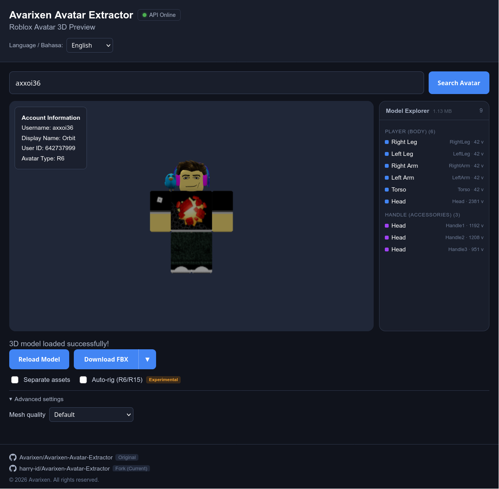

# Avarixen Avatar Extractor

Avarixen Avatar Extractor (AAE) is a web-based Roblox avatar extraction tool that retrieves avatar models, previews them in 3D, and exports them as ZIP files containing OBJ, MTL, and texture files.

## Try the demo

**[Try out the demo →](https://harry-id.github.io/Avarixen-Avatar-Extractor/)**

The live demo is hosted on GitHub Pages, with the API running on a server in Europe.

## Preview



## Requirements

- **Node.js 18+** (backend relies on the built-in `fetch` API)
- npm

## Project structure

- `backend/` – Express API server (Roblox lookup, avatar metadata/download)
- `frontend/` – Express static server + Three.js viewer UI
- `downloads/` – generated avatar assets served by the frontend at `/assets/...`

## Setup

### 1. Install dependencies

```bash
cd backend
npm install

cd ../frontend
npm install
```

### 2. Configure the backend

Create `backend/.env` from the example and set your Roblox API key:

```bash
cp backend/.env.example backend/.env
```

`backend/.env`:

```env
ROBLOX_API_KEY=your_roblox_api_key_here
# PORT=3000
# CORS_ORIGINS=http://localhost:3001
```

### Create a Roblox API key

1. Go to https://create.roblox.com/dashboard/credentials?activeTab=ApiKeysTab
2. Click **Create API Key**
3. Enter a name (e.g. `AAE Avatar Extractor`)
4. Under **Access Permissions**, add:
   - `thumbnails:read` — required for avatar metadata
   - `users.advanced:read` — optional, for user lookup
5. Click **Save & Generate**
6. Copy the key into `backend/.env` as `ROBLOX_API_KEY`

Notes:
- `ROBLOX_API_KEY` is required for avatar metadata and downloads.
- `CORS_ORIGINS` (comma-separated) — unset keeps CORS permissive (the server logs a warning); set explicit origins in production.
- `DOWNLOADS_TTL_HOURS` (default `24`) expires cached avatars; `DOWNLOADS_MAX_BYTES` adds an optional total cache quota (`0` = unlimited).
- `MAX_CONCURRENT_CONVERSIONS` (default `2`) and `MAX_CONVERSION_QUEUE` (default `8`) bound CPU-heavy GLB/GLTF/FBX work.
- Request logging is on by default. `LOG_REQUESTS=false` disables it; `LOG_REQUESTS=verbose` adds bodies/user agents; `LOG_ASSETS=1` adds per-file CDN logs (noisy).
- File logging is on by default: a clean (ANSI-stripped) copy of every console line is written to `backend/aae.log`. Set `AAE_LOG_FILE=false` to disable, `AAE_LOG_FILE=<path>` to change the location, or `AAE_LOG_LEVEL=debug|info|warn|error` (default `info`) to filter.
- Logs rotate at `AAE_LOG_MAX_BYTES` (default 10 MiB) and keep `AAE_LOG_MAX_FILES` files (default 3). Logs contain client IPs and user IDs; treat them as operational data and restrict access.

### 3. Run (single command)

From the repository root, install everything and start both servers at once:

```bash
# One-time setup (installs root + backend + frontend dependencies)
npm run setup

# Start backend + frontend together (single command)
npm start
```

- Backend: `http://localhost:3000`
- Frontend: `http://localhost:3001`

Press `Ctrl+C` to stop both servers.

> Tip: you still need to create `backend/.env` from `backend/.env.example` and set your `ROBLOX_API_KEY` before starting.

Open `http://localhost:3001`, enter a Roblox username, and load/export the avatar.

## Languages

The frontend supports **Indonesian (`id`)** and **English (`en`)**:

- A language selector in the header lets users switch languages.
- The choice is saved to `localStorage` (`aae_lang`) and persists across reloads.
- Defaults to English until the visitor chooses a language.
- Backend API error messages also honor the `Accept-Language` header, so they match the selected frontend language.

## Model Conversion

The download button is split: the main button downloads **OBJ (ZIP)**; the arrow opens a format menu.

| Format | Endpoint | Notes |
|---|---|---|
| OBJ (ZIP) | client-side | OBJ + MTL + textures |
| GLB | `GET /api/roblox/convert/:userId/glb` | self-contained binary glTF |
| GLTF | `GET /api/roblox/convert/:userId/gltf` | JSON glTF (`@gltf-transform/core`) |
| FBX | `GET /api/roblox/convert/:userId/fbx` | binary FBX 7.4 (`backend/fbx-exporter.js`) |

Download the avatar first (files live in `downloads/<userId>/`).

- **Auto-rig** (GLB/GLTF/FBX): adds an R6/R15 skeleton. R6 **More joints** (Advanced settings) adds hands, elbows, knees, feet, and a waist. Rigged FBX uses the same bones/weights as glTF.
- **Rig detection + compatibility**: the rig type is detected from the exported geometry (renamed body parts, then Player-group count), with Roblox's `playerAvatarType` used as a tie-breaker for borderline cases. A **compatibility badge** (Compatible / Partial n/15 / Incompatible) is shown in the account panel and the model explorer so you can tell at a glance which avatars will rig cleanly. Partial rigs (a missing limb segment) are still rigged with the missing bone bridged.
- **Mesh quality** (GLB/GLTF/FBX, body only — Head + `Handle*` excluded): Minimal (Default) / Low / Medium / High / Extreme = subdivision 0–4. Preserves UVs/normals, capped at ~3.5M faces. OBJ is always original geometry. More joints locks to High/Extreme and defaults to High.
- **Separate assets** → ZIP with external `.bin`/textures for GLTF/FBX; GLB is always one embedded binary; OBJ is always client-side. Unsupported options are **disabled (grayed out)**, not hidden.
- Body parts export as separate objects under a node named after the display name (no merged `character_mesh`). Accessories (`Handle*`) are **bone-parented** to the body-part bone they belong to (Head, Torso, …), so they follow the skeleton's position and rotation. R15 **layered clothing** (a `Handle*` spanning multiple body regions, e.g. a jacket over the arms + torso or trousers over both legs) is instead **skinned** to the nearest bones so it deforms with the limbs.
- GLB/GLTF/FBX are body-centered with feet at Y=0; FBX uses Blender units (`UnitScaleFactor=100`) and imports upright.
- No format stores a Blender collection — select the imported parts and press **M → New Collection**.
- OBJ is normalized on download: centered on X/Z, feet at Y=0, `g` groups mirrored as `o` objects, player groups renamed to body parts (`Head`, `Torso`, `LeftArm`, …); `Handle*` kept.
- Files are named `{safeName}_{userId}.{format}`.

## Compatibility

Exports are tested with **Blender 3.6** and **Prisma3D 3.3.5** — covering OBJ, GLB, GLTF, and FBX in standard, separate-assets, and rigged modes. See [tests.md](tests.md) for the full test matrix and per-format notes.

## Notes

- The frontend auto-detects `http://localhost:3000` in local dev; elsewhere set `window.__AAE_BACKEND_URL__` or serve the API behind the same origin.
- Avatars are cached in `downloads/<userId>/`; the Reload button re-downloads and reloads with a cache-busting query.
- Avatar metadata is retried up to 5× (1.5 s apart) while pending; auth errors fail immediately.
- Keep real API keys in `backend/.env` (never commit) and restrict its permissions (`chmod 600`).
- Rate limiting is in-memory per process. Set `TRUST_PROXY` (e.g. `1`) behind a reverse proxy so the real client IP is used; `TRUST_PROXY=false` explicitly disables proxy trust. Use a shared store/gateway for multi-instance.
- Downloads for the same user are serialized and written through a staging directory, so concurrent requests cannot interleave cache files.
- `HEAD` requests to the download/conversion endpoints return `405`; those endpoints are GET-only and have side effects.

## Tests

```bash
npm test
```

The backend test suite uses the built-in `node:test` runner and covers OBJ/MTL parsing, body-part mapping, texture planning, i18n, FBX serialization, upstream timeouts, configuration parsing, cache locks/quotas, log rotation, and conversion limits.

